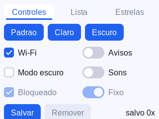
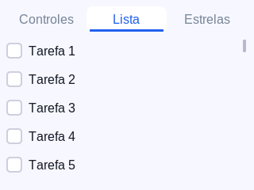

# cydui

Immediate-mode UI library in C for small embedded displays, targeting the ESP32 "Cheap Yellow Display" (ESP32-2432S028R: ILI9341 320x240 + XPT2046 touch). egui-style API, strip-based rendering (no full framebuffer), swappable themes from clean/modern to retro to cyberpunk.

**Status:** version **0.4.0**, iteration 4: drawing core, strip rasterizer, in-memory and SDL backends, UTF-8 text with bitmap fonts, and an immediate-mode UI with ids, state, touch input, layout (alignment, cards), label/button/checkbox/toggle/slider/progress/tabs, scroll areas with inertia, virtual lists, themes switchable at run time (`clean` in a light and a dark variant) and an API for widgets of your own. **The public API is frozen** by a test: see [`docs/11-api.md`](docs/11-api.md). Not yet: the ESP32 backend (next), text input, popups, animation, the `retro` and `cyberpunk` themes. See [`docs/`](docs/) for requirements, threat model, the iteration plan and the [core design](docs/10-core-design.md); the [changelog](CHANGELOG.md) lists what changed.

   

```c
CYDUI_STORAGE(storage, 320, 240, 20, 192, 1024, 32);   /* all the memory, as one static object */

cydui_ui ui;
cydui_ui_init(&ui, &CYDUI_CONFIG(storage, &backend, &theme));
while (cydui_ui_begin(&ui, theme.style.bg)) {
    CYDUI_CARD(&ui) {
        cydui_label(&ui, "New task");
        CYDUI_ROW(&ui) {
            cydui_set_main_align(&ui, CYDUI_PLACE_END);
            if (cydui_button(&ui, "Cancel")) cancel();
            if (cydui_button(&ui, "Add")) add();
        }
    }
    cydui_ui_end(&ui);
}
```

## Building and running (PC)

```sh
cmake -S . -B build -G Ninja && cmake --build build
ctest --test-dir build                    # unit tests and golden images

# sanitizers (ASan/UBSan) and, with clang, a short fuzz run of the command parser
cmake -S . -B build/clang -G Ninja -DCMAKE_C_COMPILER=clang -DCYDUI_SANITIZE=ON
cmake --build build/clang && ctest --test-dir build/clang
./build/examples/shapes/shapes            # demo scene in an SDL window (needs SDL2)
./build/examples/text/text                # text demo: press or drag the mouse to reflow a paragraph
./build/examples/hello/hello              # a button and a counter: 22 lines of C
./build/examples/widgets/widgets          # every widget and layout; the mouse is the touch screen
./build/examples/theme-gallery/theme-gallery   # the widgets in each theme, a list of 200 tasks, a custom widget; the buttons switch theme
./build/examples/shapes/shapes --headless --hash --png shapes.png
```

Golden images: the hash of each scene is in `tests/golden/`, and every run writes the PNGs to `build/golden/`.
After an intended rendering change, look at the PNGs and run `CYDUI_UPDATE_GOLDEN=1 ./build/tests/test_golden`.

There is no hosted CI. Checks run on the developer machine (an untracked `ci.sh` script chains the builds above, a short fuzz run, the static checks and the analyzers).

The public API is the one in `docs/11-api.md`; `tests/test_api_surface.c` stops the build if a signature, an enumerator or a field changes. To add API, add lines to it (`tools/gen_api_surface.py` writes the entries); to change API, follow the rules at the end of `docs/11-api.md`.

## ESP-IDF

ESP-IDF v5.5.x is expected in `~/esp/esp-idf`. Load it with:

```sh
source tools/env.sh
```

Hardware probe (finds the real pins/orientation of your board):

```sh
cd examples/hw-probe
idf.py build
idf.py -p /dev/ttyUSB0 flash
```

You need to be in the `uucp` group (Arch) or `dialout` (Debian/Ubuntu) to access the serial port.

## Fonts

`fonts/` holds bitmap fonts generated by `tools/fontgen.py` (a `cydui_font` is constant data: a sorted glyph table plus 4-bit coverage bitmaps). The bundled `cydui_sans_{12,16,24}` are renderings of Liberation Sans and stay under the **SIL Open Font License 1.1** (`fonts/LICENSE-OFL.txt`), not the MIT license; they are named without "Liberation" because the OFL reserves that name for unmodified fonts.

```sh
python3 -m venv tools/.venv && tools/.venv/bin/pip install -r tools/requirements.txt   # once
tools/gen_fonts.sh            # regenerate fonts/
tools/gen_fonts.sh --check    # fail if fonts/ differs from the generator output
tools/.venv/bin/python tools/fontgen.py --ttf Some.ttf --size 14 --name my_font_14 \
    --chars "U+0020-U+007E,U+00E0-U+00FF" --out my_font_14 --preview "Olá, mundo"
```

## License

The code is MIT. The fonts in `fonts/` are under the SIL OFL 1.1 (see above).
