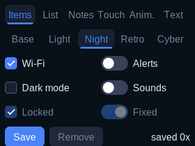
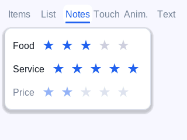

# cydui

**A touch UI for the ESP32 "Cheap Yellow Display" that you can read in an afternoon.** Buttons, lists, text fields with an on-screen keyboard, themes and animations in pure C99, on the cheap 320x240 ILI9341 + XPT2046 board (CYD, ESP32-2432S028R). No malloc, no framebuffer, no code generator: you call a function, you get a widget.

[](LICENSE) [](https://github.com/gventino/cydui/tags)  

   

```c
CYDUI_CARD(&ui) {
    cydui_label(&ui, "New task");
    cydui_text_input(&ui, "Name", name, sizeof name, 24, 0);          /* tap it: a keyboard appears */
    CYDUI_ROW(&ui) {
        if (cydui_button(&ui, "Cancel")) cancel();
        if (cydui_button(&ui, "Add"))    add(name);
    }
}
```

## From zero to a button on your board in 5 minutes

```sh
git clone https://github.com/gventino/cydui && cd cydui
tools/doctor.sh                          # what is missing on this computer, and how to get it
tools/new-project.sh ~/my-gadget         # a ready ESP-IDF project for the CYD, already pointing at this library
cd ~/my-gadget && source ~/esp/esp-idf/export.sh    # (or this library's tools/env.sh)
idf.py build flash monitor               # the first start asks for five touches to calibrate the screen
```

No board yet, or just curious? The same widgets run in a window on your PC (needs SDL2; `--headless` writes a PNG without it):

```sh
cmake -S . -B build -G Ninja && cmake --build build
./build/examples/theme-gallery/theme-gallery    # every widget in five themes; the mouse is the touch screen
```

Something looks wrong on the real screen (inverted colors, mirrored touch)? [`docs/13-troubleshooting.md`](docs/13-troubleshooting.md) is a table of symptoms and the one option that fixes each.

## Why this and not LVGL or TFT_eSPI widgets?

- **You own the memory.** One `CYDUI_STORAGE(...)` static block that you size; the library never allocates, and `cydui_ui_stats_get()` tells you how much a screen really uses. Nothing to tune in a config header the size of a novel.
- **Immediate mode.** The screen is a function of your state, rebuilt every frame: `if (cydui_button(&ui, "Add")) add();`. No widget tree to create, hold and free.
- **Fast enough on a cheap board.** A full frame draws in 11.5 ms on the ESP32; with dirty regions only the strips that changed are sent (an animation runs at about 100 fps).
- **Small enough to read.** About 5,700 lines of C99 in `src/`. When something looks wrong you can find out why.
- **Hard to crash.** Hostile text and touches cannot corrupt memory or hang the screen; the core is fuzzed and sanitizer-tested, and every picture is pinned by a golden hash that the board reproduces bit for bit.
- **A real application behind it:** [cyd-todo](https://github.com/gventino/cyd-todo), a quest-log to-do list and calendar with a Rust server and Wi-Fi setup by QR code, was written on this API and sent its findings back (that is what 1.0.0-rc.2 is).

Not for you if you need rich vector graphics, a design tool, many fonts and languages out of the box, or a screen other than a small TFT (it is built for 320x240; the display backend is a few hundred lines if you want to port one).

## What is in it

| | |
|---|---|
| **Widgets** | label, wrapped label, button, check box, switch, slider, progress, tabs, scroll areas, virtual lists, text field and text area, popups (modal), the keyboard on the screen (letters, numbers, symbols, Latin-1 accents) |
| **Look** | themes as a table plus painters: `clean` (light and dark), `retro`, `cyberpunk` (glow, scanlines, glitch); fonts as constant bitmap data (Liberation Sans bundled, make your own with `tools/fontgen.py`); tweens and easings |
| **Yours** | a documented way to write your own widget, painter, post-effect and backend (`docs/12-guide.md`) |
| **Board** | ESP-IDF 5.5 component: display driver, XPT2046 touch with a filter and a five-point calibration kept in the flash, backlight, a pixel hash to compare with the PC |
| **PC** | SDL window and a headless mode; unit tests, golden images, fuzzers |

## Where to go next

| I want to... | Read |
|---|---|
| fix a wrong color, a mirrored touch, a black screen | [`docs/13-troubleshooting.md`](docs/13-troubleshooting.md) |
| size the memory, write a theme, a widget, animate | [`docs/12-guide.md`](docs/12-guide.md) |
| know exactly what is stable | [`docs/11-api.md`](docs/11-api.md) and the comments in `include/cydui/*.h` |
| see a whole application | [cyd-todo](https://github.com/gventino/cyd-todo) |
| know what changed | [`CHANGELOG.md`](CHANGELOG.md) |
| report a vulnerability | [`SECURITY.md`](SECURITY.md) |

**Status:** release candidate **1.0.0-rc.2**. The API has been frozen since 0.4.0 (additions only; each is listed in the changelog) and `v1.0.0` comes when the application that stresses it ships its first release.

## Text input

```c
static char name[32];
...
if (cydui_text_input(&ui, "Name", name, sizeof(name), 24, 0) & CYDUI_TEXT_CONFIRMED) { save(name); }
cydui_text_area(&ui, "Notes", notes, sizeof(notes), 0, 3, 0);              /* 3 rows, wraps, like an HTML textarea */
if (cydui_popup_begin(&ui, "Delete?", &ask, 240, 110, CYDUI_POPUP_MODAL)) { /* a confirmation nothing can bypass */
    cydui_label(&ui, "Delete this?");
    if (cydui_button(&ui, "Delete")) { remove_it(); ask = false; }
    cydui_popup_end(&ui);
}
```

A tap on a field gives it the focus and a keyboard appears on the screen (letters, numbers, symbols, Latin-1 accents); `cydui_keyboard_top()` says where it begins. A backend can also feed `CYDUI_EVENT_CHAR` and `CYDUI_EVENT_KEY` events (the SDL backend does it with the keyboard of the computer), which is how an application could receive text from somewhere else, for example a web page that the board serves (not part of the library).

## Animation and effects

```c
/* a value that moves to its target: the first call starts at 0, a new target goes there from where it is */
int32_t alpha = cydui_animate(&ui, cydui_id_str(&ui, "fade"), 0, shown ? 255 : 0, 200, CYDUI_EASE_OUT_QUAD);

cydui_set_theme(&ui, &cyberpunk);        /* a theme can carry a post-effect: scanlines, a glitch, an entrance sweep */
cydui_set_effects_level(&ui, CYDUI_FX_LOW); /* ... and be turned down when the frame rate suffers */
```

The widgets of a theme with `style.anim_ms` > 0 change their look over that time (buttons, check boxes, switches, tabs). Everything follows the clock of the backend, so a test with a made-up clock sees the same frame as the board: the gallery prints 42 hashes (30 pages in five themes, 12 at the times of the effects of `cyberpunk`) that are the same on the PC and on the ESP32. `cydui_ui_end` returns true while something moves; when it returns false the application may sleep. A full 320 x 240 redraw is bound by the SPI at 40 MHz (about 26 frames per second); animations that change a few strips run at 90 to 100, and at 80 MHz a full redraw of `cyberpunk` is 35 fps.

## Security and limits

The library is meant for a device on a home network that other people can touch, and it is written so that **hostile data cannot corrupt memory or hang the screen**; what it cannot do for you is listed here. The threat model is in [`docs/05`](docs/05-threat-model-stride.md), the controls and what tests each in [`docs/06`](docs/06-controls-and-risks.md).

- **Fixed memory, hard limits.** Nothing is allocated and the core has no mutable globals. Every arena has the size you gave at init and **drops** what does not fit (raising a `CYDUI_ERR_*` flag), never writing outside it. Limits you can raise at build time: `CYDUI_MAX_STR` (256 bytes per drawn string), `CYDUI_MAX_WIDGETS` (512 per frame), `CYDUI_MAX_ID_DEPTH`, `CYDUI_MAX_LAYOUT_DEPTH`, `CYDUI_MAX_TWEENS` (16) and `CYDUI_ANIM_MAX_MS` (5 s), `CYDUI_KEY_QUEUE` (32), the event queue (32).
- **Input is validated.** Text is strict UTF-8 (overlong forms, surrogates, truncated sequences become one replacement character); control characters and bidirectional marks are drawn as a box; a text field never cuts a character, never exceeds your buffer or its character limit, and accepts a newline only in a text area; touch coordinates are clamped to the screen and a calibration that is not finite, degenerate or inaccurate is refused. Bitmaps and fonts are checked against their declared sizes. A password field draws bullets only.
- **Tested hard.** The test suite covers 97 % of the lines of the core; the library, text editing, UTF-8 decoding, touch filter and calibration, easings and the whole UI layer (random widgets, touches, keys, themes, popups, clocks) are fuzzed with libFuzzer under AddressSanitizer and UBSan; the rasterizer is compared pixel by pixel with a plain reference. The ESP32 firmware is built with the strong stack protector, heap poisoning and `-Wformat-security`.
- **What you must still do.** The library is **not thread-safe**: call it from one task (a debug build reports a call from another). **Code you give it is trusted**: a post-effect, a painter, a backend and a custom widget run inside the library with pointers into its memory. A modal popup stays until your code closes it. A password lives in your buffer, which the library does not wipe. A hostile *application* can still make one frame expensive (hundreds of full-screen commands take seconds on the ESP32 — widgets draw small rectangles, so it takes a bug, not an input); the task watchdog is fed every strip.
- **Residual risks (R-20 to R-22).** Someone with physical access to a board without secure boot and flash encryption can read the flash (Wi-Fi credentials, tokens) and reflash the device: enable them in a release build if that matters to you (CT-18, CT-19; the library does not touch secrets). Letters that look alike (Cyrillic and Latin) can still be used to forge a text; only control characters and bidi marks are filtered, and the bundled fonts cover Latin-1 only, which already narrows it. The ESP-IDF Wi-Fi and TLS stacks are out of scope: keep ESP-IDF updated.

To report a vulnerability see [`SECURITY.md`](SECURITY.md).

## Building and running (PC)

```sh
cmake -S . -B build -G Ninja && cmake --build build
ctest --test-dir build                    # unit tests and golden images

# sanitizers (ASan/UBSan) and, with clang, a short fuzz run of the command parser
cmake -S . -B build/clang -G Ninja -DCMAKE_C_COMPILER=clang -DCYDUI_SANITIZE=ON
cmake --build build/clang && ctest --test-dir build/clang
./build/examples/shapes/shapes            # demo scene in an SDL window (needs SDL2)
./build/examples/text/text                # text demo: press or drag the mouse to reflow a paragraph
./build/examples/hello/hello              # a button and a counter: 22 lines of C
./build/examples/widgets/widgets          # every widget and layout; the mouse is the touch screen
./build/examples/theme-gallery/theme-gallery   # the widgets in each theme, a list of 200 tasks, a custom widget, text fields; a tab bar switches among the five themes (the keyboard of the computer types into a focused text field); `--theme 0..4 --tab 0..5 --at MS` renders one state headless
./build/examples/shapes/shapes --headless --hash --png shapes.png
```

Golden images: the hash of each scene is in `tests/golden/`, and every run writes the PNGs to `build/golden/`.
After an intended rendering change, look at the PNGs and run `CYDUI_UPDATE_GOLDEN=1 ./build/tests/test_golden`.

There is no hosted CI. Checks run on the developer machine (an untracked `ci.sh` script chains the builds above, a short fuzz run, the static checks and the analyzers).

The public API is the one in `docs/11-api.md`; `tests/test_api_surface.c` stops the build if a signature, an enumerator or a field changes. To add API, add lines to it (`tools/gen_api_surface.py` writes the entries); to change API, follow the rules at the end of `docs/11-api.md`.

## ESP-IDF

To start a project of your own use `tools/new-project.sh` (above). This section is for the examples of the repository.

ESP-IDF v5.5.x is expected in `~/esp/esp-idf`. Load it with:

```sh
source tools/env.sh
```

Hardware probe (finds the real pins/orientation of your board):

```sh
cd examples/hw-probe
idf.py build
idf.py -p /dev/ttyUSB0 flash
```

You need to be in the `uucp` group (Arch) or `dialout` (Debian/Ubuntu) to access the serial port.

The theme gallery on the board (the same `gallery.c` as the PC program, with the touch screen):

```sh
cd examples/theme-gallery/idf
idf.py build && idf.py -p /dev/ttyUSB0 flash
python3 ../../../tools/serial_capture.py -p /dev/ttyUSB0 -t 60 --reset   # the GALLERY_* lines: hashes, speed, memory
```

With no calibration in the flash it asks for five touches on crosses at the first start (a stylus is better than a finger); the **Calibrate** button of the touch page does it again. `CONFIG_GALLERY_ACCEPTANCE` runs a guided accuracy and latency test on the screen. After adding a Kconfig symbol run `idf.py reconfigure`. The clock (40 MHz default, 80 MHz opt-in), the rotation (0 or 180) and the pins are Kconfig options of the backend (`backends/esp32/Kconfig`).

## Fonts

`fonts/` holds bitmap fonts generated by `tools/fontgen.py` (a `cydui_font` is constant data: a sorted glyph table plus 4-bit coverage bitmaps). The bundled `cydui_sans_{12,16,24}` are renderings of Liberation Sans and `cydui_mono_16` (for the `retro` theme) a one-bit rendering of Liberation Mono; they stay under the **SIL Open Font License 1.1** (`fonts/LICENSE-OFL.txt`), not the MIT license; they are named without "Liberation" because the OFL reserves that name for unmodified fonts.

```sh
python3 -m venv tools/.venv && tools/.venv/bin/pip install -r tools/requirements.txt   # once
tools/gen_fonts.sh            # regenerate fonts/
tools/gen_fonts.sh --check    # fail if fonts/ differs from the generator output
tools/.venv/bin/python tools/fontgen.py --ttf Some.ttf --size 14 --name my_font_14 \
    --chars "U+0020-U+007E,U+00E0-U+00FF" --out my_font_14 --preview "Café, naïve"
```

## License

The code is MIT. The fonts in `fonts/` are under the SIL OFL 1.1 (see above).
