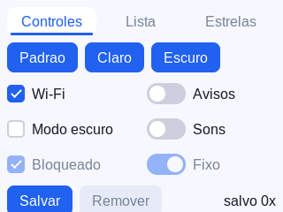
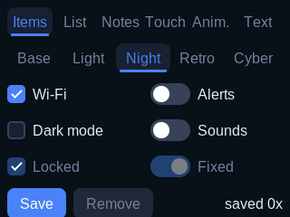

# 11 — The Public API (frozen at 0.4.0, additions in 0.5.0, 0.6.0, 0.7.0 and 1.0.0-rc.2; release candidate 1.0.0-rc.2)

This is the contract of `include/cydui/*.h`. It is enforced by `tests/test_api_surface.c`: every function below is bound there to a pointer of its exact type, every enumerator and constant has its value, and every field of the stable structs has its type. A change to that file is an API change, and the rules of the last section apply.

The comments in the headers are the reference for each function (arguments, limits, what happens with a bad argument). This page says what is stable and where to look.

 

## Stability

| Tier | What | Promise |
|---|---|---|
| **Stable** | Every function, macro, type, enumerator and flag listed below. The value of every enumerator and flag bit. The fields and types of the structs that the application fills or reads. The behavior written in the header comments. | Changes only by the rules at the end. |
| **Stable, low level** | `cydui_alloc`, `cydui_interact`, `cydui_state_get`, `cydui_take_mods`, `cydui_widget_begin`, `cydui_label_len`, `cydui_draw_text_in`, `cydui_state_of`, the `cydui_id_*` functions, `cydui_paint`, `cydui_wstyle_of`. What you use to write a widget of your own ("writing a widget" in `ui.h`). | Same promise; the semantics are subtler, so read the comments. |
| **Tunable** | Macros guarded by `#ifndef` (`CYDUI_SCROLL_*`, `CYDUI_MAX_*`, `CYDUI_EVENT_*`, `CYDUI_POLL_PER_FRAME`, `CYDUI_STATE_TTL`, `CYDUI_FILTER_CONTROL`). | The **name** is stable. The **default value** may change in any version (it is noted in the CHANGELOG): the feel of the scrolling is tuned on the board in It5. |
| **Private** | See "What is not API". | May change without notice. |

## What is not API

- Every name with the prefix `cydui__` and `src/ui_internal.h`.
- `struct cydui_ui`, `cydui_region` and `cydui_input`, and every field of them. They are declared in `ui.h` only because the application provides the memory (`CYDUI_STORAGE`); the only thing that is promised about them is that `sizeof(cydui_ui)` is what the application's storage must hold. Read what the touch did from `cydui_response`, not from `ui->in`.
- `cydui_ctx` and `cydui_arena` internals (use the functions).
- Anything in `src/`, `backends/`, `themes/`, `examples/` and `tests/`. The shipped themes (`cydui_theme_init_clean`, `cydui_theme_init_clean_dark`) and the example widget (`rating`) are examples built on this API, with their own, looser, promise: their look may change.
- The numbers `sizeof(cydui_cmd)`, `sizeof(cydui_ui)` and the like: they depend on the target (the PC and the ESP32 differ).

## Functions

### Setup and version
| | |
|---|---|
| `cydui_init`, `cydui_ui_init` | Build the drawing context / the whole UI from caller-provided memory. Return 0 or a `CYDUI_ERR_*` flag. No allocation, ever. |
| `cydui_version` | `"1.0.0-rc.1"`, also `CYDUI_VERSION_MAJOR/MINOR/PATCH/STRING`. |
| `CYDUI_STORAGE`, `CYDUI_CONFIG` | Declare the memory of a UI and the config that points at it. |

### Frame
| | |
|---|---|
| `cydui_ui_begin`, `cydui_ui_end` | Start and end a frame. `end` renders it in strips and returns true when another frame is wanted soon (a layout still settling, a press, something coasting). |
| `cydui_ui_errors`, `cydui_ui_clear_errors`, `cydui_ui_frame` | The `CYDUI_ERR_*` flags raised so far; the frame counter. |
| `cydui_begin_frame`, `cydui_end_frame`, `cydui_errors`, `cydui_clear_errors`, `cydui_cmd_count`, `cydui_strip_height` | The same at the level of the drawing context, for an application without the UI layer. |
| `cydui_invalidate` (0.5.0) | Makes the next frame send every strip again. With `cydui_config.dirty_mem` the core sends only the strips whose commands changed since the previous frame; with `strip_buffers = 2` it alternates two strip buffers so the backend can send one while the next is drawn (`backend.h` has the contract). Both are optional and off by default. |

### Drawing primitives (all clipped, all integer)
`cydui_draw_rect`, `cydui_draw_rrect`, `cydui_draw_rrect_outline`, `cydui_draw_line`, `cydui_draw_bitmap` (RGB565, 4-bit mask or, since 1.0.0-rc.2, a 1-bit mask), `cydui_draw_bitmap_a1` (a 1-bit mask with every bit a whole-number scale of pixels), `cydui_draw_gradient`, `cydui_draw_text`, `cydui_set_clip`, `cydui_reset_clip`, and `cydui_raster_strip` (what a backend calls). Colors: `cydui_blend`, `cydui_color_unpack`, `CYDUI_RGB`. Geometry: `cydui_rect_intersect`, `cydui_rect_empty`.

### Text and fonts
`cydui_text_size`, `cydui_text_iter_init`, `cydui_text_next_line`, `cydui_text_resolve`, `cydui_text_clip_len`, `cydui_utf8_decode`, `cydui_font_validate`, `cydui_font_lookup`, `cydui_font_fallback`, `cydui_font_glyph_data`, `cydui_glyph_bytes`, `cydui_bitmap_size`, `cydui_arena_init`, `cydui_arena_alloc`, `cydui_arena_reset`. Text is UTF-8, at most `CYDUI_MAX_STR` bytes are used; invalid bytes become the fallback glyph.

### Ids and state
| | |
|---|---|
| `cydui_id_str`, `cydui_id_eq`, `cydui_id_claim` | The id of a label (text up to `##` is shown, all of it is hashed); compare; mark it used in this frame (collision detection in debug builds). |
| `cydui_push_id_str`, `cydui_push_id_int`, `cydui_push_id_ptr`, `cydui_pop_id` | Mix a value into the ids until the matching pop (lists). Ids do **not** depend on the container hierarchy. |
| `cydui_state_get` | The 32-byte entry (`a`..`d` are yours) that lives while the id keeps being used (`CYDUI_STATE_TTL` frames). |

### Layout
| | |
|---|---|
| `cydui_begin_row/column/grid/padding/card`, `cydui_end_*`, `CYDUI_ROW/COLUMN/GRID/PADDING/CARD` | Containers, nested up to `CYDUI_MAX_LAYOUT_DEPTH`; deeper ones are ignored (with `CYDUI_ERR_LAYOUT`). A card is a padded column with the theme's panel exactly as big as its content, already in the first frame. |
| `cydui_set_spacing`, `cydui_set_cross_align`, `cydui_set_main_align` | How the children of the open container are placed (`CYDUI_PLACE_START/CENTER/END`). Alignment takes its sizes from the previous frame; `cydui_ui_end` asks for another frame while they settle. |
| `cydui_spacer`, `cydui_spacer_fill` | Empty space. |
| `cydui_next_width/height/fill/stretch/disabled` | One-shot modifiers for the next widget or container. |
| `cydui_take_mods`, `cydui_alloc`, `cydui_alloc_rect`, `cydui_layout_avail` | The place of a widget; what a widget of your own calls. |

### Widgets
`cydui_label`, `cydui_label_wrapped`, `cydui_button`, `cydui_checkbox`, `cydui_toggle`, `cydui_slider` (int32 range, keeps the press), `cydui_progress`, `cydui_tabs` (up to `CYDUI_MAX_TABS`). Each returns true in the frame the user changed something. At most `CYDUI_MAX_WIDGETS` per frame are processed. `cydui_slider_knob_x` and `cydui_slider_value_at` give the knob geometry to painters.

### Scroll areas and lists
`cydui_scroll_begin`, `cydui_scroll_end`, `CYDUI_SCROLL`, `cydui_scroll_to`, `cydui_list_begin`, `cydui_begin_list_item`, `cydui_end_list_item`, `cydui_list_end`. Dragging scrolls and lets go into a coast (integer friction, driven by the backend clock; no overscroll); a drag that began on a button takes the touch from it; a widget with `CYDUI_CAPTURE` (the slider) is not taken over. A list builds only the rows in `[first, last)`; its content is at most `CYDUI_LIST_MAX_PX`. Scroll areas do not nest.

### Text fields, popups and the keyboard on the screen (0.6.0)
| | |
|---|---|
| `cydui_text_input`, `cydui_text_area` | A field of one line (`CYDUI_TEXT_PASSWORD` draws bullets) and a field of several lines that wrap, editing a string of the application (`buf`, `cap`, an optional `max_chars`). Return `CYDUI_TEXT_CHANGED` / `CYDUI_TEXT_CONFIRMED` bits. A tap gives the focus; only the focused field takes the typed characters. A refused character outlines the field for 400 ms. |
| `cydui_focus_set`, `cydui_focus_clear`, `cydui_has_focus` | The focus. A press anywhere else, Enter on a single line field, Escape, or a field that is not called for a frame, drops it. |
| `CYDUI_EVENT_CHAR`, `CYDUI_EVENT_KEY`, `cydui_key`, `cydui_event.key` | A backend (or the application) gives characters and editing keys; the `key` field is a code point or a `CYDUI_KEY_*`. `sizeof(cydui_event)` is 12 now. |
| `cydui_textedit_*` | The editing of a UTF-8 string in a buffer (insert, backspace, delete, move, normalize), with no UI: safe for a buffer with no NUL, a cap of 0 or 1 and any cursor. |
| `cydui_popup_begin`, `cydui_popup_end`, `CYDUI_POPUP_MODAL` | A panel above everything that takes the touch while it is shown; closed by a press outside or Escape unless it is modal. One at a time; it takes no room in its container. |
| `cydui_keyboard_top`, `cydui_keyboard_enable` | The keyboard is shown by the library while a field has the focus (letters, numbers, symbols, Latin-1 accents); the application only leaves the field above `cydui_keyboard_top` (a field inside a scroll area is scrolled there by the library) or turns the keyboard off. |

### Animation, post-effects and the clock (0.7.0)
| | |
|---|---|
| `cydui_animate(ui, id, from, target, duration_ms, ease)` | A value that moves to its target: it starts at `from` the first time, and goes from where it is to every new target along `ease` (`CYDUI_EASE_LINEAR`, `_IN/_OUT/_IN_OUT_QUAD`, `_IN/_OUT/_IN_OUT_CUBIC`, `_OUT_BACK`, `_OUT_ELASTIC`; integers only, `cydui_ease_apply` and `cydui_lerp` are in `anim.h`). Kept in the state table, apart from the state of a widget with the same id. With no clock, a duration of 0 or no free entry in the state table the value is the target at once. At most `CYDUI_MAX_TWEENS` (16) move together (`CYDUI_ERR_TWEEN_LIMIT`), a duration is cut to `CYDUI_ANIM_MAX_MS` (5000), and `cydui_ui_end` returns true while one moves. |
| `cydui_now`, `cydui_theme_age` | The clock of the frame, and the ms since the theme in use came in (for an entrance). |
| `cydui_post_effect`, `cydui_set_post_effect(ctx, fx)` | A function that changes every strip after it is drawn and before it is sent (`apply(user, buf, width, y0, h)`), with a `key(user, y0, h)` that says what it will do to those rows and takes part in the dirty-region hash, so a time dependent effect resends only the strips it changes. It must depend on the absolute row, never on the strip. |
| `cydui_set_effects_level`, `cydui_effects_level`, `CYDUI_FX_NONE/LOW/FULL`, `CYDUI_FX_DEFAULT` | What a theme may spend on its effects; a theme that has none ignores it. |
| `cydui_theme.post`, `cydui_style.anim_ms` | A theme can carry a post-effect (it receives the `cydui_ui` as `user`) and a duration for the changes of look of its widgets (buttons, check boxes, switches, tabs, the dimming of a popup); 0 = at once, which is what every theme built before 0.7.0 gets. |
| `cydui_paint_look`, `cydui_paint_amount`, `cydui_paint_info.mix/from_state/from_selected` | For a painter: the look of the widget between two states while it changes, and how selected it is (a switch places its knob with it). `mix` 0 means settled. |

### Additions of 1.0.0-rc.2 (from the first real application)
| | |
|---|---|
| `cydui_ui_stats_get`, `cydui_ui_stats_reset`, `cydui_ui_stats` | The peaks of commands, text bytes, tweens and widgets in any frame, the state entries in use, and the configured sizes: what to measure to size `CYDUI_STORAGE`. `CYDUI_ERR_STATE_FULL` is raised when a state entry that is still in use had to be replaced or none could be made (not for a table of no entries, not for a tween that finds no room). |
| `cydui_theme.user` | A `const void *` of the application, never read by the library, that a painter finds as `theme->user`. NULL by default. |
| `cydui_text_fit`, `cydui_text_ellipsize` | The bytes of the longest start of a text that fits a width **as drawn**, cut on a character boundary; and the same with an ellipsis (U+2026, or three dots if the font lacks it) into a buffer that is never overrun and always terminated. |
| `cydui_style.font_small`, `cydui_style.font_title`, `cydui_font_role`, `cydui_theme_font` | Optional other fonts of a theme (NULL = the body font); the body font stays `style.font` and is what the widgets of the library use. A theme with an unusable optional font is refused like one with an unusable body font. |
| `cydui_next_font`, `cydui_next_color`, `cydui_next_alpha` | One-shot modifiers for the next `cydui_label` or `cydui_label_wrapped` (font, text color, alpha); every other widget forgets them. |
| `CYDUI_BITMAP_A1`, `cydui_draw_bitmap_a1`, `cydui_cmd.u.bitmap.scale` | One bit per pixel (most significant bit first, rows padded to a byte), tinted, every bit a `scale` x `scale` square (1 to 8). `sizeof(cydui_cmd)` does not change. |

### Themes
| | |
|---|---|
| `cydui_theme_default`, `cydui_style_default`, `cydui_theme_derive_table` | A dark theme around a font; a starting point for a palette-only theme. |
| `cydui_theme_validate`, `cydui_set_theme`, `cydui_theme_of` | A bad theme is refused and the current one stays; switching asks for another frame and touches no state. |
| `cydui_wstyle_of`, `cydui_paint`, `cydui_paint_default` | The look of a widget kind in a state; paint through the theme; what an override painter calls to add to the default. |

### Writing a widget
`cydui_widget_begin`, `cydui_take_mods`, `cydui_id_str` + `cydui_id_claim`, `cydui_label_len`, `cydui_text_size`, `cydui_alloc`, `cydui_interact` (with `CYDUI_SENSE_CLICK`, `CYDUI_SENSE_DRAG`, `CYDUI_CAPTURE`, `CYDUI_DISABLED`; the response says where the pointer is), `cydui_draw_text_in`, `cydui_state_of`, `cydui_state_get`. `examples/theme-gallery/rating.c` is a complete one, built from the public headers alone.

## Types and flags
Structs the application fills or reads: `cydui_config`, `cydui_ui_config`, `cydui_backend`, `cydui_event`, `cydui_font`, `cydui_glyph`, `cydui_style`, `cydui_wstyle`, `cydui_paint_info`, `cydui_theme`, `cydui_response`, `cydui_mods`, `cydui_state`, `cydui_id`, `cydui_rect`, `cydui_cmd`, `cydui_text_extent`, `cydui_text_iter`, `cydui_text_line`.

| Error flag | Bit | Meaning |
|---|---|---|
| `CYDUI_ERR_CMD_OVERFLOW` | 1 | command list full, command dropped |
| `CYDUI_ERR_BAD_ARG` | 2 | invalid argument, ignored |
| `CYDUI_ERR_NO_MEMORY` | 4 | caller-provided memory too small |
| `CYDUI_ERR_BAD_BITMAP` | 8 | bitmap data shorter than its size |
| `CYDUI_ERR_TEXT_TRUNCATED` | 16 | text cut at `CYDUI_MAX_STR` (informative) |
| `CYDUI_ERR_ID_COLLISION` | 32 | two widgets, one id in a frame (debug builds) |
| `CYDUI_ERR_LAYOUT` | 64 | nesting error: too deep, unbalanced, misplaced |
| `CYDUI_ERR_TOO_MANY_WIDGETS` | 128 | more than `CYDUI_MAX_WIDGETS` in a frame |
| `CYDUI_ERR_THREAD` | 256 | called from another task than the one that created the UI |
| `CYDUI_ERR_FRAME_BUDGET` | 512 | (0.5.0) the frame passed `frame_budget_ms`; the widgets still to be called were skipped |
| `CYDUI_ERR_TWEEN_LIMIT` | 1024 | (0.7.0) more than `CYDUI_MAX_TWEENS` tweens moving at once; the extra ones jumped to their target |
| `CYDUI_ERR_STATE_FULL` | 2048 | (1.0.0-rc.2) the state table was full and an entry still in use had to be replaced, or none could be made |

Interaction flags: `CYDUI_SENSE_CLICK` 1, `CYDUI_SENSE_DRAG` 2, `CYDUI_DISABLED` 4, `CYDUI_CAPTURE` 8. `cydui_style` and `cydui_paint_info` grew at their end in 0.7.0 (`anim_ms`; `mix`, `from_state`, `from_selected`) and `cydui_theme` got `post` at its end: code that fills them by name and zeroes the rest is unchanged. Widget kinds and states (`cydui_widget_kind`, `cydui_widget_state`) have the order in `theme.h`; new kinds are only added at the end (0.6.0 adds `CYDUI_WIDGET_TEXT_INPUT`, `CYDUI_WIDGET_POPUP` and `CYDUI_WIDGET_KEY`, so `cydui_theme` is bigger; a theme built by `cydui_theme_derive_table` or a `clean` one has them, a theme filled by hand gets plain panels).

## Changing the API

The API has been frozen since 0.4.0 and the release candidate keeps it. Until `v1.0.0` (which comes after `cyd-todo`, the application that stresses the API, has been written on it) a change of a signature is still possible, but only when all of this is in the same commit; from 1.0.0 it needs a new **major** version:

1. an entry in `CHANGELOG.md` under "API changes", saying what changed and how to adapt;
2. `tests/test_api_surface.c` and this page updated (adding API means adding lines; changing or removing a line is the break);
3. the version incremented in `include/cydui/cydui.h`.

A **patch** version never changes a signature, an enumerator value, a flag bit or a documented behavior. Adding API (a function, a macro, an enumerator at the end, a new error bit) does not break anything and only needs the lines in the test.

The tag is per iteration (`v0.4.0`, `v0.5.0`, ..., `v1.0.0-rc.1`, `v1.0.0-rc.2`).
